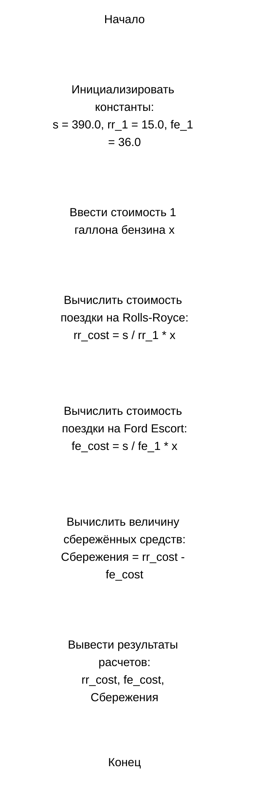

Домашнее задание к работе 2

Условие задачи:
Человеку нужно съездить из Лондона в расположенный в 390 милях Эдинбург. Он может ехать на автомобиле марки “Роллс-Ройс” либо на автомобиле марки “Форд Эскорт”. “Роллс-Ройс” расходует 1 галлон бензина на каждые 15 миль пути. “Форд-Эскорт” расходует 1 галлон бензина на каждые 36 миль пути. Сколько будет стоить поездка в Эдинбург на “Роллс-Ройсе”, если стоимость 1 галлона бензина составляет х фунтов? Сколько денег он сбережет, если вместо этого поедет на машине марки “Форд-Эскорт”.

1. Алгоритм и блок-схема

1) Начало
2) Объявить константы:
	• s = 390.0 — расстояние между Лондоном и Эдинбургом (в милях).
	• rr_1 = 15.0 — количество миль, которое Rolls-Royce проезжает на 1 галлоне топлива.
	• fe_1 = 36.0 — количество миль, которое Ford Escort проезжает на 1 галлоне топлива.
3) Задать исходные данные:
	• x — стоимость 1 галлона бензина в фунтах стерлингов.
4) Вычислить стоимость поездки на Rolls-Royce:
	• rr_cost = (s / rr_1) * x
5) Вычислить стоимость поездки на Ford Escort:
	• fe_cost = (s / fe_1) * x
6) Вычислить величину сбережённых средств:
	• Сбережения = rr_cost - fe_cost
7) Вывести результаты расчетов с подстановкой всех значений в текст.
8) Конец

2. Реализация программы
   
#include <stdio.h>
#include <locale.h>

int main() {

	setlocale(LC_CTYPE, ".UTF8");
    float s = 390.0f;
    float rr_1 = 15.0f;
    float fe_1 = 36.0f;
    float x;

    printf("Введите стоимость 1 галлона бензина: ");
    scanf_s("%f", &x);

    float rr_cost = (s / rr_1) * x;
    float fe_cost = (s / fe_1) * x;

    printf("Стоимость поездки на Rolls-Royce: %.2f\n", rr_cost);
    printf("Стоимость поездки на Ford Escort: %.2f\n", fe_cost);
    printf("Денег сбережет, если поедет на машине Ford Escort: %.2f\n", rr_cost - fe_cost);

    return 0;}

4. Результаты работы программы
Ввод:
50
Вывод:
Стоимость поездки на Rolls-Royce: 1300.00
Стоимость поездки на Ford Escort:  541.67
Денег сбережет, если поедет на машине Ford Escort:  758.33

5. Информация о разработчике
Чернышова А.А., группа бИД-261.
